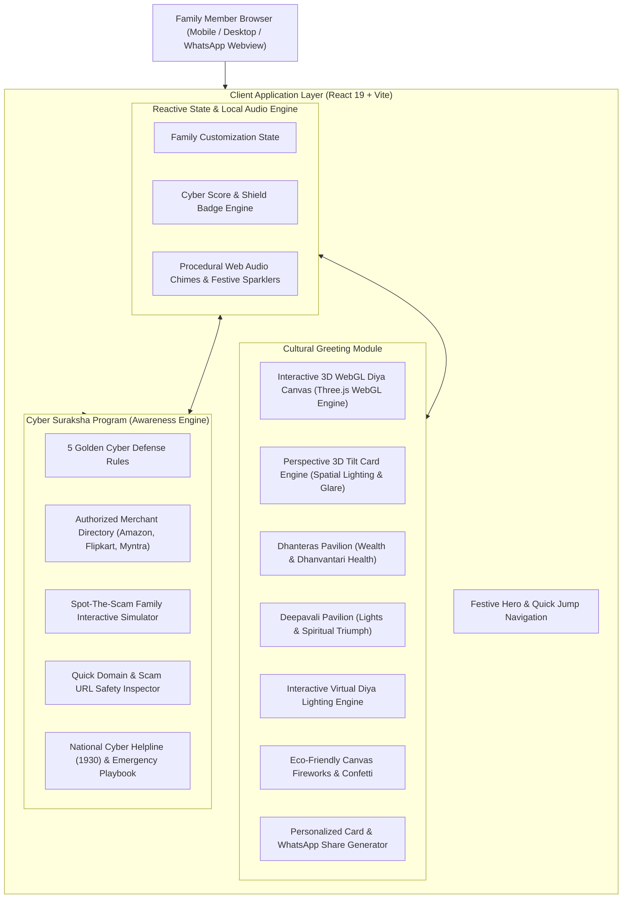

# System Architecture Document (ARCHITECHTURE.md)

## 1. High-Level Architecture
The application is architected as an ultra-responsive, mobile-first React 19 single-page application built on Vite and Tailwind CSS. It integrates interactive celebratory physics engines (Canvas Fireworks, Confetti, and procedural Diya flame renderers) alongside an interactive Cyber Safety evaluation engine.



---

## 2. Component Hierarchy & Directory Topology
```
diwali-cyber-suraksha/
├── index.html                   # HTML5 entry with Google Fonts & festive meta tags
├── vite.config.ts               # Vite build configuration (base: './')
├── tsconfig.json                # Strict TypeScript configuration
├── package.json                 # Dependencies and build scripts
├── PRD.md                       # Product Requirements Document
├── ARCHITECHTURE.md             # System Architecture & Topology (this file)
├── ARCHITECTURE.md              # Symlink to ARCHITECHTURE.md
├── DESIGN.md                    # Visual design language & token specifications
├── MEMORY.md                    # Engineering decisions and creator context
├── RULES.md                     # Engineering & AI agent guidelines
├── TRACKER.md                   # Task checklist and milestone tracker
├── GEMINI.md                    # AI documentation synchronization directives
└── src/
    ├── main.tsx                 # React DOM mount root
    ├── index.css                # Global styles, Tailwind imports, custom keyframe glow animations
    ├── App.tsx                  # Root layout coordinator
    ├── types.ts                 # TypeScript data contracts & interfaces
    ├── data/
    │   ├── greetingsData.ts     # Authentic Sanskrit shlokas, festive blessings, and cultural context
    │   ├── cyberRulesData.ts    # 5 Festive cyber hygiene principles, real attack vectors
    │   ├── scamQuizData.ts      # 5 Realistic festive scam scenarios & evaluation keys
    │   └── authorizedAppsData.ts # Trusted e-commerce ecosystem directory (Amazon, Flipkart, Myntra, etc.)
    ├── components/
    │   ├── Navbar.tsx           # Festive navigation bar with quick emergency 1930 button
    │   ├── FestiveHero.tsx      # Dual Dhanteras + Diwali festive banner with audio chime
    │   ├── VirtualDiyaStage.tsx # Interactive Diya lighting & Gold coin shower canvas
    │   ├── GreetingCardStudio.tsx # Custom greeting generator with WhatsApp direct share
    │   ├── CyberRulesSection.tsx# Visual guide on fake links, unauthorized discounts, and UPI rules
    │   ├── AuthorizedStorefronts.tsx # Verified platform directory with safe domain verification tips
    │   ├── ScamSimulatorQuiz.tsx # "Spot the Scam" interactive test & family score certificate
    │   ├── UrlSafetyChecker.tsx # Interactive domain inspector tool for testing suspicious festive links
    │   ├── EmergencyResponse.tsx# National Cyber Helpline (1930), CyberCrime.gov.in & bank freeze steps
    │   ├── FireworksCanvas.tsx  # Dynamic particle cracker/sparkler canvas
    │   └── Footer.tsx           # Creator attribution (Om Shrikrishna Gautam) & festive copyright
    └── utils/
        ├── audio.ts             # Web Audio API procedural bell / diya chime generator
        └── confetti.ts          # Particle burst triggers for celebratory milestones
```

---

## 3. Data Integrity & Client-Side Security
1. **Zero External Tracking**: The application requires no telemetry or external tracking scripts, respecting family privacy.
2. **Safe Link Navigation**: External links to official portals (`cybercrime.gov.in`, `amazon.in`, `flipkart.com`, `myntra.com`) use `rel="noopener noreferrer"` and explicit domain warnings.
3. **No Dynamic Code Execution**: User input in the Greeting Card Studio is strictly sanitized through standard React JSX string binding without `dangerouslySetInnerHTML`.
4. **Offline Resilience**: All visual effects, quiz questions, audio synthesizers, and verified merchant signatures operate fully client-side without API dependencies.

